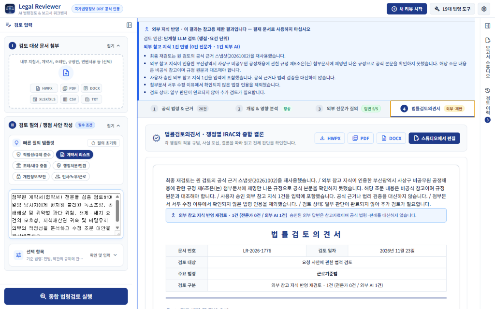
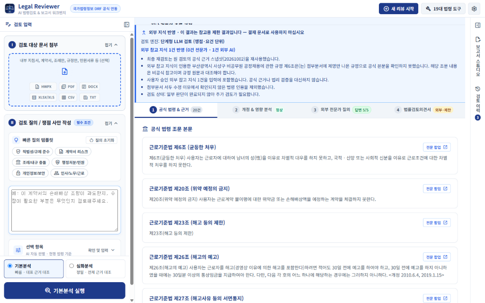
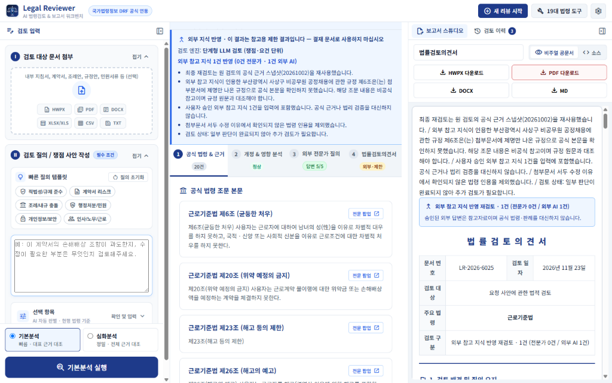

# Legal Reviewer

**Legal Reviewer**는 국가법령정보센터 공식 API와 로컬 AI(Ollama)를 결합하여 법률 문서를 분석하고, 공식 조문·판례 근거 검증과 **HWPX · PDF · DOCX** 공공 표준 서식 보고서 생성을 한 번에 처리하는 로컬 법률 검토 워크벤치입니다.

> **유의사항**: AI가 생성한 검토 의견은 실무 보조용 참고 자료입니다. 최종 의사결정이나 결재 전에는 근거 조문, 적용 시점, 사실관계를 담당자가 반드시 직접 확인해야 합니다.

---

## 1. 빠른 시작 (Windows 원클릭 설치 및 실행)

신규 PC에서는 아래 두 배치 파일만으로 설치부터 실행까지 끝낼 수 있습니다.

### Step 1. 환경 자동 설치 (`setup.bat`)

저장소를 내려받은 폴더에서 **`setup.bat`** 을 실행하세요. 다음 항목을 자동으로 점검하고 설치합니다.

1. **Node.js 22 LTS 이상** 확인 및 자동 설치 (`node:sqlite` 내장 모듈 사용)
2. **필수 npm 패키지** 설치 (`npm ci` / `npm install`)
3. **로컬 LLM 엔진(Ollama)** 확인 및 자동 설치
4. **필수 로컬 AI 모델 다운로드**:
   - `gemma4:e2b` — 기본 법리 추론·검토 모델
   - `bge-m3` — 판례·해석례 의미 검색(임베딩) 모델
5. **데이터 디렉토리(`data/cache`, `data/uploads`) 및 `.env` 환경설정 파일** 생성

> **국가법령정보 API 키(`LAW_OC`) 안내**: 공식 법령과 판례를 실시간 조회하려면 [국가법령정보 공동활용(open.law.go.kr)](https://open.law.go.kr)에서 OpenAPI를 신청해 발급받은 `OC` 값(신청 계정 ID)이 필요합니다. `setup.bat` 실행 중 안내가 나올 때 바로 입력하거나, 나중에 `.env` 파일의 `LAW_OC=` 항목에 입력할 수 있습니다. (`LAW_OC`가 비어 있으면 공식 법령 조회가 `UNAVAILABLE`로 제한되며, UI 테스트용 샘플은 `LAW_DEMO_MODE=true`로 체험할 수 있습니다.)

### Step 2. 시스템 실행 (`start.bat`)

설치가 끝난 뒤 **`start.bat`** 을 실행하면:

1. 로컬 Ollama 서비스 상태를 확인하고, 꺼져 있으면 백그라운드에서 자동 기동합니다.
2. Legal Reviewer 서버(`http://localhost:3000`)를 시작합니다.
3. 서버가 준비되면 **기본 웹 브라우저가 자동으로 열립니다.**

*(macOS / Linux 환경에서는 Node.js 22+ 및 Ollama를 설치하고 `ollama pull gemma4:e2b && ollama pull bge-m3`, `cp .env.example .env`, `npm install` 후 `./run.sh` 또는 `npm start`로 실행합니다.)*

---

## 2. 화면 구성 및 기본 사용법

화면은 **좌측 입력 패널** · **중앙 결과 패널** · **우측 보조 패널(보고서 스튜디오 / 검토 이력)** 의 3단 구조로 구성되어 있습니다.

### ① 검토 입력 (좌측 패널)

1. **I. 검토 대상 문서 첨부 (선택)**: `HWPX`, `PDF`, `DOCX`, `XLSX/XLS`, `CSV`, `TXT` 파일을 드래그하거나 클릭해 첨부합니다. 표(Table)와 `제O조-항-호` 계층 구조를 자동으로 추출합니다.
2. **II. 검토 질의 / 쟁점 사안 작성 (필수)**:
   - **빠른 질의 템플릿** 6종(`적법성/규제 준수`, `계약서 리스크`, `조례/내규 충돌`, `행정처분/민원`, `개인정보/보안`, `인사/노무/근로`) 중 하나를 누르면 실무용 질의 문구와 권장 기준 법령이 자동 입력됩니다. (직접 작성도 가능하며, 적극행정 사전 컨설팅감사 신청서 첨부·질의 시 갑설·을설 비교 전용 보고서도 지원합니다.)
   - **선택 항목**을 펼치면 `기준 대상 법령`과 `검토 기준 시점`(과거 특정 날짜 기준 소급 법령 조회)을 직접 지정할 수 있습니다.
3. **종합 법령검토 실행**: 버튼을 누르면 상단 실시간 진행 패널에서 `준비 → 수집 → 분석 → 작성 → 검증` 단계와 예상 진행률(%)을 확인할 수 있습니다.

### ② 4대 결과 탭 (중앙 패널)

| 탭 | 주요 내용 |
|---|---|
| **1. 공식 법령 & 근거** | 국가법령정보센터에서 수집한 공식 법령 조문 원문, 의미 유사도+LLM 2단계 선별 판례·유권해석례, 행정규칙·조례·별표 |
| **2. 개정 & 영향 분석** | 첨부 문서의 위험 조항 탐지, 인용 조문과 현행 법령의 4열 대조표, 소관 법령 최근 개정 연혁 |
| **3. 외부 전문가 질의** | 로컬 AI가 판단하기 어려운 공백 쟁점을 비식별 질의서로 반출하고, 외부 답변을 지식 카드로 승인해 재검토 |
| **4. 법률검토의견서** | 조문 실존성 검증 결과(`UNVERIFIED` 구분), 쟁점별 IRAC 심층 분석, 신·구 조문 대비표, HWPX/PDF/DOCX 원클릭 다운로드 |

### ③ 보고서 스튜디오 & 검토 이력 (우측 패널)

- **보고서 스튜디오**: 의견서를 **비주얼 공문서** 또는 **마크다운 소스** 형태로 직접 수정한 뒤 `HWPX`, `PDF`, `DOCX`, `MD` 파일로 내려받을 수 있습니다.
- **검토 이력**: 모든 검토 스냅샷이 브라우저 로컬 저장소(`IndexedDB`)에 영구 저장되며, 언제든 클릭 한 번으로 이전 검토를 복원할 수 있습니다.

---

## 3. 주요 설정 및 부가 기능

### AI 모델 및 외부 전송 보안 설정 (우측 상단 ⚙ 버튼)

- **내부 LLM만 사용 (기본)**: 모든 분석을 PC 내 로컬 Ollama(`gemma4:e2b` 등)로 처리하며 문서가 외부로 전송되지 않습니다.
- **내부 + 외부 LLM 병용**: 로컬 모델이 풀지 못한 쟁점(최대 3건)만 개인정보 비식별 처리 후 사용자의 미리보기·승인을 거쳐 외부 LLM(LG EXAONE, OpenAI, Anthropic, Google Gemini)에 재질의합니다.
- **외부 LLM만 사용**: 실행할 때마다 비식별 처리된 전송 본문을 직접 확인·승인한 뒤 외부 LLM으로 검토합니다. (전송 이력은 `data/cache/external-audit.jsonl`에 기록됩니다.)

### 19대 법령 도구 (상단 `19대 법령 도구` 버튼)

전체 검토를 실행하지 않고도 법령 검색(`searchLaw`, `searchAiLaw`), 조문·시점별 조문 조회(`articleDetail`, `articleAt`), 신·구 조문 비교(`articleDiff`), 인용 적합성 대조(`impactMap`), 판례·해석례·재결례·행정규칙·조례·별표 조회 등 17종의 실행 도구를 개별 호출할 수 있습니다.

### 주요 환경변수 요약 (`.env`)

전체 항목은 [`.env.example`](.env.example)을 참고하세요.

| 변수 | 기본값 | 설명 |
|---|---|---|
| `PORT` / `HOST` | `3000` / `127.0.0.1` | 서버 포트 및 바인딩 주소 |
| `LAW_OC` | *(빈 값)* | 국가법령정보센터 OpenAPI 계정 ID |
| `LLM_PROVIDER` | `ollama` | 기본 LLM 제공자 (`ollama`, `exaone`, `openai`, `anthropic`, `gemini`) |
| `OLLAMA_URL` | `http://localhost:11434` | Ollama 서버 주소 |
| `OLLAMA_MODEL` | `gemma4:e2b` | 기본 추론 모델 |
| `OLLAMA_EMBED_MODEL` | `bge-m3` | 판례·해석례 선별용 로컬 임베딩 모델 |
| `REVIEW_PIPELINE` | *(자동)* | `staged` 지정 시 토큰 분할 단계형(S0~S7) 경로 우선 사용 |

---

## 4. 테스트 및 상세 기술 문서

- **단위 테스트**: `npm test` (외부 통신을 차단한 픽스처 기반 검증)
- **공식 API 통합 테스트**: `npm run test:integration` (`LAW_OC` 설정 시 실제 국가법령 API 계약 검증)
- **조문 요건 사전 캐시 예열**: `node scripts/warmElements.js "근로기준법" "개인정보 보호법"`

더 깊은 아키텍처, 파이프라인 단계(S0~S7), 분석 품질 개선 내역 및 실측 자료는 아래 문서를 참고하세요.

- [현재 구현·검증 상태 통합 문서](docs/current-status.md)
- [단일 호출 vs 단계형 파이프라인 실측 비교](docs/audit/pipeline-comparison-2026-09-23.md)
- [검토 테스트용 샘플 문서 5종 안내](test/docs/review-samples/README.md)
