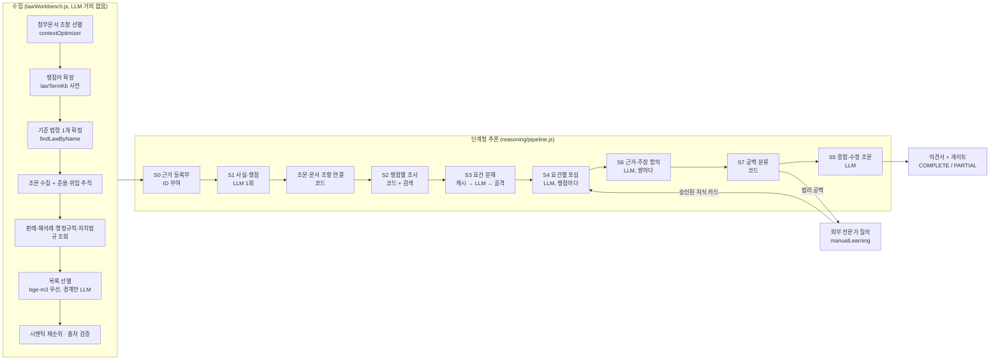
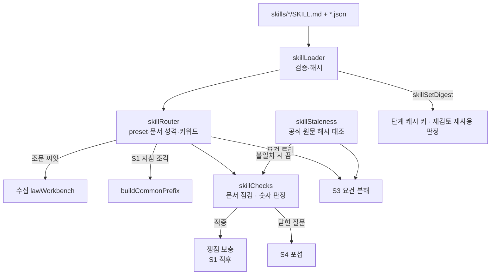

# 법령 분석 로직 심층 분석과 분석 스킬 도입 계획

기준일: 2026-11-28 · 대상 커밋: `fd26da0` · 스킬 명세: [skills/skills.md](../skills/skills.md)

이 문서는 (A) 현재 법령 분석 로직과 프로세스의 심층 분석, (B) Claude가 법령을 분석할 때 쓰는 분석 스킬, (C) 이 시스템에 맞는 스킬의 선정 근거, (D) 구현 계획을 담는다.
수치는 `docs/audit/analysis-depth-verification-2026-11-23.md`의 사례 01 단일 측정에서 가져왔다. 전문가가 검수한 정답이 아니다.

---

## A. 현재 법령 분석 로직·프로세스 심층 분석

### A1. 전체 흐름

### A2. 단계별 로직

| 단계 | 파일 | LLM | 하는 일 | 모델 출력을 믿기 전에 코드가 하는 확인 |
|---|---|---|---|---|
| 수집 | `server/law/lawWorkbench.js` | 목록 선별 경계 후보만 | 기준 시점 결정, 기준 법령 확정(후보 순서대로, 이름이 정확히 같을 때만), 인용 조문·사전 추천 조문 합집합 수집, 준용·위임 추적, 판례·해석례 2단계(목록 → 공식 본문) | 과거 시점 본문을 못 받으면 현행으로 대체하지 않음, 문서 자체 조문(SELF)을 상위법 조문으로 끌어오지 않음 |
| S0 | `reasoning/evidenceRegistry.js`, `prompts.js` | — | 조문·항·단서·판례 명제·문서 조항에 ID 부여, 공통 접두부를 입력 예산에 맞게 줄임 | 공식 여부·시행 여부를 항목마다 기록 |
| S1 | `stages/caseIssues.js` | 1회 (길면 조각별) | 사실(인용 포함)·쟁점(유형·우선순위·선결관계·근거 ID·검색어) 추출 | 사실 인용이 원문에 없으면 `INFERRED`로 강등, 없는 근거 ID 제거, 2-gram 0.8 이상 중복 병합, 선결관계 순환 끊기 |
| 연결 | `stages/statuteLinking.js` | — | 쟁점에 조문이 2개 미만이면 질문·검색어 어휘 일치로 조문 후보 보충, 쟁점에 문서 조항 연결 | 서로 다른 단어 2개 이상 일치 또는 문서 직접 인용만 후보 |
| S2 | `stages/issueResearch.js` | 목록 선별 | 쟁점 검색어·조문 번호로 판례·해석례 추가 조사, 쟁점별 근거 정렬, 조문 단서를 반대 후보로 항상 포함 | 공식 본문(FULL_TEXT)만 등록, 정렬 점수는 순서용 |
| S3 | `stages/elements.js` | 캐시 미스 조문마다 | 조문을 요건(필수·택일·예외·논리 묶음)으로 분해 | 출처 ID가 호출에 준 원문 단위인지, 누락 단위는 골격 보충, 실패 시 골격(결론에 영향 없음) |
| S4 | `stages/application.js` | 쟁점 × 요건 묶음 × 근거 묶음 | 요건별 충족 판단 또는 문서 판단(`COMPLIES/VIOLATES/NOT_ADDRESSED/UNCLEAR` + 원문 인용) | 인용이 문서에 글자 그대로 있어야 판단 인정(공백 차이만 허용), 원문 미확인 사실로는 입증 충분 불가, 묶음 간 판단 충돌은 `DISPUTED` |
| 결론 | `verify/conclusion.js` | — | 요건 판단에서 쟁점 결론을 규칙으로 계산(필수·택일 묶음·예외·선결 쟁점), 조건부 시나리오 | 서술이 유보 결론과 달리 단정하면 경고 |
| S6 | `verify/warrant.js` | 주장 × 근거 × 조각 | 존재·공식·시점 확인, 임베딩 정렬, 원문 함의(SUPPORTS/PARTIAL/NOT_SUPPORTED) | 일부 조각만 봤으면 NOT_SUPPORTED를 PARTIAL로, 기본분석의 미대조는 `NOT_CHECKED` |
| S7 | `stages/gaps.js` | — | 결론 요건의 공백만 법리(외부 질의)·사실(사용자)·수집(재수집)으로 분류 | 사실 확인 표현은 외부로 보내지 않음, 질의 12개 상한 초과는 미룸 |
| S5 | `stages/synthesis.js` | 1~2회 | 요약, 수정 조문(심화분석) | 판단이 한 건도 없으면 의견서 대신 원인 안내 |
| 게이트 | `pipeline.js` | — | 게이트 사유를 모아 `COMPLETE` / `PARTIAL`, 기본분석은 항상 `PARTIAL` | — |

### A3. 설계상 강점

1. **결론은 코드가 계산한다.** 모델은 요건 상태만 내고, 요건 하나가 미확정인데 확정 결론이 나오는 일이 구조적으로 막혀 있다.
2. **인용은 ID로만 한다.** 없는 조문을 지어내면 ID 검증에서 걸린다.
3. **원문 대조가 여러 겹이다.** 사실 인용(S1), 문서 판단 인용(S4), 근거 함의(S6).
4. **실패해도 멈추지 않는다.** 골격 요건, 쟁점별 실패 격리, 예산 초과 시 분할.
5. **공백을 성격별로 보낸다.** 사실 공백은 사용자에게, 법리 공백만 비식별 질의서로.
6. **비용을 의식한 설계.** 접두부 고정(KV 캐시), 추출 단계 think 끔, 출력 길이 상한, 기본분석과 심화분석 분리, 재검토 시 S1~S3 재사용.

### A4. 구조적 약점과 병목

| # | 약점 | 근거 | 영향 |
|---|---|---|---|
| W1 | **쟁점 구성에 도메인 지식이 없다.** S1 지시문의 검토 유형별 방향은 한 줄(`prompts.js:26` `PRESET_FOCUS`)이다 | 막연한 선결 쟁점(I1)이 후속 쟁점 결론을 막음, 경업금지·위약벌 쟁점을 로컬·외부 모델 모두 놓침 | 빠진 쟁점은 이후 단계가 아무리 정확해도 되살아나지 않는다 |
| W2 | **조문 재현율이 쟁점 연결에 묶인다.** (구현 중 정정) 사례 01에서는 제20·54·60조도 공식 본문으로 **수집은 됐다**(P0 등록부 A2·A11·A13). 의견서 인용에서 빠지는 것은 그 조문을 다루는 쟁점이 서지 않거나 쟁점에 연결되지 않기 때문이다 | 기대 조문 재현율 44~67%, 제20·54·60조가 반복 누락 | 의견서가 핵심 조문 없이 작성된다 |
| W3 | **로컬 모델이 열린 판단을 못 한다.** 문서 판단 방식은 거짓 결론은 막았지만 탐지력이 0이다 | 로컬: 위반 인용 0/37, 사실 2개 / 외부 EXAONE: 위반 인용 다수, 사실 24개 | 로컬 전용 운영 원칙에서는 쓸모 있는 지적이 나오지 않는다 |
| W4 | **비용이 출력 생성에 몰린다** | S4가 모델 시간의 75%, 모델 시간의 73%가 출력 생성, 심화분석 약 59분 | 실무에서 심화분석을 돌리기 어렵다 |
| W5 | **도메인 규칙이 흩어져 있다** | `PRESET_FOCUS`, `documentProfile.js` TYPES, `contractReview.js` RULES·CLAUSE_CHECKS·AUTHORITY_HINTS, `verifiedRules.js` ARTICLE_EXPECTATIONS, `gaps.js` FACT_QUESTION, `pipeline.js` 검토 유형별 쟁점 상한 | 법률 전문가가 고칠 수 없고, 버전이 `PROMPT_VERSION` 하나에 묶이며, 어느 규칙이 어느 시험에 걸리는지 보이지 않는다 |
| W6 | **법령 개정을 감지하지 못한다** | `ARTICLE_EXPECTATIONS`처럼 조문 번호가 코드에 고정돼 있다 | 개정 후에도 옛 조문 기대가 남는다 |
| W7 | **인용 대조가 엄격하다** | 공백 차이만 허용 | 모델이 문장을 요약해 인용하면 위반을 놓친다 |
| W8 | **측정 기반이 얇다** | 사례 01 한 건을 한 번씩, 정답셋 미검수, 사례 02~05는 최신 코드로 재측정 안 함 | 개선 효과와 측정 잡음을 가르기 어렵다 |

**요약:** 분석 방법(무엇을 어떤 순서로 확인하는가)은 이미 잘 짜여 있다. 결과를 가르는 것은 (1) 어떤 조문과 쟁점을 시야에 넣는가(W1·W2)와 (2) 5B 모델이 답할 수 있는 형태로 질문하는가(W3·W4)다. 둘 다 **도메인 지식**과 **질문 형태**의 문제이며, 스킬이 해결할 대상이다.

---

## B. Claude가 법령을 분석한다면 쓰는 스킬

이 세션의 Claude Code에 설치된 스킬(docx·pdf·xlsx·deep-research·skill-creator 등)에는 법령 분석 전용 스킬이 없다. 이번 분석도 코드와 문서를 직접 읽어 수행했다. 스킬을 만든다면 Claude는 아래 **방법 스킬**을 기본으로 쓰고, 사안마다 **도메인 스킬** 하나를 더한다.

| 방법 스킬 | Claude가 하는 일 | 이 시스템의 대응 |
|---|---|---|
| 쟁점 구성 | 질의·문서에서 다툼이 되는 법률 효과를 찾아 "~인가?" 쟁점으로, 선결·후속 관계를 세운다. 문서 확인 같은 비쟁점은 버린다 | S1 (막연한 선결 쟁점 방지만 약함) |
| 법령 체계 탐색 | 법률 → 시행령 → 시행규칙 → 고시, 위임·준용, 특별법 우선, 기준 시점과 부칙 경과규정 | 수집 단계 (기준 법령 1개에 치우침) |
| 요건 분해 | 요건과 효과, 원칙과 단서, 열거 호의 택일 구조 | S3 |
| 포섭 | 사실을 요건에 대응시키되 문서 원문을 인용한다 | S4 |
| 반대 논리·판례 구별 | 가장 강한 반대 견해와 결정적 사실의 같고 다름 | S4 counter·precedents (심화분석) |
| 근거 검증·결론 등급 | 인용한 근거가 그 명제를 실제로 말하는지, 결론의 확실성 수준 | S6, 결론 계산, 게이트 |

Claude 같은 대형 모델은 도메인 지식(근로기준법 제53조가 1주 12시간 한도라는 것)을 이미 알고 있어서 방법 스킬만으로도 쟁점을 찾는다. **gemma4:e2b는 그 지식이 없고, 긴 방법 지시도 잘 따르지 못한다.** 그래서 Claude에게 맞는 스킬 구성과 이 시스템에 맞는 스킬 구성이 다르다. C에서 이 차이를 근거로 고른다.

Claude Code 쪽에서는 스킬을 만들 때 `skill-creator`의 평가 반복(시험 사례 → 실행 → 채점)을 쓸 수 있다. 다만 이 시스템의 런타임 스킬은 로컬 엔진이 읽는 데이터 패키지이므로, 평가는 저장소의 `test/benchmark/pipelineBaseline.js`로 한다.

---

## C. 이 시스템에 최적인 스킬

### C1. 판단 기준

이 시스템의 제약: 로컬 전용(클라우드 자동 호출 없음), CPU 위의 gemma4:e2b(디코드 약 17토큰/초, 5.2k 토큰 입력 처리 14~39초), 출력 토큰 수가 곧 시간, 접두부가 같아야 KV 캐시 재사용.

| 기준 | 설명 |
|---|---|
| 정확도 효과 | W1~W3 중 무엇을 메우는가 |
| 비용 | 추가 입력·출력 토큰, 호출 수 |
| 5B 적합성 | 소형 모델이 안정적으로 해낼 형태인가 |
| 검증 가능성 | 결과를 코드로 확인할 수 있는가 |
| 유지보수 | 법률 전문가가 고치고 검수할 수 있는가 |

### C2. 후보 비교

| 후보 | 방식 | 정확도 효과 | 비용 | 5B 적합성 | 판단 |
|---|---|---|---|---|---|
| ① 방법 스킬 프롬프트 주입 | Claude식 분석 절차를 S1·S4 지시문에 길게 싣는다 | 낮음. 방법은 이미 코드에 있다 | 입력 증가(단계마다 수천 자) | 낮음. 긴 지시를 따르지 못한다 | **채택 안 함.** 금지 쟁점 문구(M1)만 짧게 둔다 |
| ② 모델이 스킬을 고르는 도구 호출형 | 스킬 색인을 보여 주고 모델이 필요한 스킬을 불러 쓴다 | 중간 | 색인 입력 + 도구 왕복 | 낮음. 선택이 매번 바뀌고 도구 호출이 불안정하다 | **채택 안 함** |
| ③ **도메인 지식 팩 + 코드 점검 + 닫힌 질문** | 코드가 스킬을 고르고, 조문 씨앗·쟁점 점검표·문서 점검·요건 트리를 각 단계에 넣는다. 모델에게는 예/아니오만 묻는다 | 높음. W1·W2·W3를 직접 메운다 | 낮음. 출력이 짧고 숫자 판정은 호출이 없다 | 높음. 닫힌 질문은 소형 모델이 잘한다 | **채택** |
| ④ 외부 LLM으로 상향 | 어려운 쟁점을 외부 모델로 | 높음(EXAONE 측정) | 외부 전송·승인 | — | 운영 원칙(로컬 전용, 외부 전문가 질의 경로)과 맞지 않아 **기본 경로로 삼지 않음** |

### C3. 스킬별 우선순위

1. **D1 취업규칙** — 측정 사례·정답셋·알려진 위반 4건(연장 68시간, 구두·메신저 해고 통지, 청문 없는 즉시 해고, 동의 없는 불이익 변경)이 있어 효과를 바로 잴 수 있다.
2. **D2 계약** — 이미 코드로 구현된 규칙의 이관. 새 정확도보다 W5(분산)·W6(시효) 해소가 목적이고, 회귀 시험이 갖춰져 있다.
3. **D3 개인정보** — 표 문서라 행 단위 점검이 코드로 잘 된다.
4. **D4 행정처분** — 의견제출 기간 같은 숫자 점검이 많다.
5. **D5 조례**, 6. **D6 사전컨설팅** — 점검보다 쟁점 구성 지침의 비중이 크다.

---

## D. 구현 계획

### D1. 구조

### D2. 새 모듈과 변경 지점

| 구분 | 파일 | 내용 |
|---|---|---|
| 신규 | `server/skills/skillLoader.js` | 머리말 파서(YAML 부분집합), 절 추출, JSON 스키마 검증, 내용 해시, `skillSetDigest` |
| 신규 | `server/skills/skillRouter.js` | `selectSkills`, `skillAuthoritySeeds`, `skillPromptFragment` |
| 신규 | `server/skills/skillChecks.js` | `runSkillChecks`(정규식·숫자 판정·인용 확보), `coverSkillIssues`, 닫힌 질문 스키마 |
| 신규 | `server/skills/skillElements.js` | 검수 요건 트리를 S3 결과로 공급 (`source: SKILL`) |
| 신규 | `server/skills/skillStaleness.js` | 스킬 기록 해시·시행일과 공식 본문 대조 |
| 신규 | `skills/labor-work-rules/*` | D1 패키지 |
| 변경 | `server/law/lawWorkbench.js:124` | 키워드 확장 직후 스킬 조문 씨앗 병합 (`contractSeeds`와 같은 방식) |
| 변경 | `server/reasoning/prompts.js:26,42` | 발동 스킬이 있으면 `PRESET_FOCUS` 대신 스킬 S1 지침, `PROMPT_VERSION`과 별개로 `skillSetDigest` 기록 |
| 변경 | `server/reasoning/pipeline.js:168,181,237` | S0 직후 점검·시효 확인, 재검토 재사용 판정에 스킬 다이제스트 비교, S1 직후 쟁점 보충 |
| 변경 | `server/reasoning/stages/elements.js:147,151` | 캐시 조회 앞에 스킬 요건 트리, 캐시 키에 스킬 다이제스트 |
| 변경 | `server/reasoning/stages/application.js:188,198` | 쟁점에 걸린 스킬 점검이 있으면 닫힌 질문 경로를 먼저 실행하고, 해소되지 않은 요건만 기존 포섭으로 |
| 변경 | `server/reasoning/verify/conclusion.js` | 스킬 상한(`ceiling`) 적용, `derivedBy: SKILL_RULE` 표기 |
| 변경 | `server/reasoning/stages/gaps.js:18` | 스킬 `사실 질문 안내`로 사실 공백 문장 생성 |
| 변경 | `server/reasoning/stages/synthesis.js` `renderReview` | "적용 분석 스킬" 절과 스킬 기원 표기 |
| 변경 | `test/benchmark/pipelineBaseline.js`, `compareRuns.js` | 발동 스킬·점검 적중·스킬 쟁점 수를 결과 JSON에 기록하고 비교 |

### D3. 단계별 일정

| 단계 | 작업 | 완료 기준 | 예상 |
|---|---|---|---|
| **P0 기준선** | 사례 01 기본분석을 현재 코드로 다시 측정해 비교 기준 JSON 저장. 기존 실패 3건(`LLM_MODEL_BUDGETS` 환경 의존)을 시험 환경에서 고정 | 기준 JSON, `npm test` 362/362 또는 실패 원인 고정 | 0.5일 + 측정 약 10분 |
| **P1 골격** | 로더·라우터·스키마, `skills/labor-work-rules`의 SKILL.md·authorities.json, 조문 씨앗 병합, S1 지침 교체, 다이제스트를 캐시 키·재검토 판정에 연결, 진행 화면 표시 | 로더 단위 시험, 사례 01 **기대 조문 수집률**(공식 본문 확보 기준) 측정 | 2일 |
| **P2 점검·닫힌 질문** | `checks.json`(LB-01~11), `runSkillChecks`, 숫자 판정, S4 닫힌 질문 경로, 상한 적용, `status: shadow`로 결과만 기록 | 점검별 `negativeExamples` 시험 통과, 대조 문서 오탐 0, shadow 결과로 사례 01의 알려진 위반 4건 중 탐지 수 측정 | 3일 |
| **P3 쟁점 보충·요건 트리** | `issues.json`과 `coverSkillIssues`, `elements.json`(제53조 제1항·제94조 제1항·제27조)과 시효 확인 | 정답셋 `expectedIssues` 4개 재현, `mustNotConclude` 위반 0, 요건 트리 해시 불일치 시 경고 시험 | 2일 |
| **P4 활성화 판정** | shadow 결과 검토 후 D1을 `active`로(전문가 검수 기록 필요). 기본분석·심화분석 각각 재측정 | 아래 D4 지표 충족 | 1일 + 측정 |
| **P5 이관** | D2 계약 규칙 이관(동작 동일), D3 개인정보, D4 행정처분 | 기존 계약·개인정보 회귀 시험 통과, 스킬별 정답셋 사례 추가 | 스킬당 2~3일 |
| **P6 운영** | 스킬 관리 화면(발동 근거·버전·검수 상태), 외부 전문가 질의 지식 카드 → 스킬 개정 후보 목록 | 화면 확인, 후보 목록이 자동 반영되지 않음을 시험으로 확인 | 2일 |

### D4. 측정 지표와 목표 (사례 01, 기본분석, 로컬 gemma4:e2b)

| 지표 | 현재 | P4 목표 | 측정 |
|---|---|---|---|
| 기대 조문 재현율 | 44~56% | 80% 이상 | `scoring.js` `scoreCitations` |
| 정답셋 쟁점 재현 (`expectedIssues`) | 경업금지·위약벌 누락 | 4/4 | `goldSet.js` |
| 문서 인용으로 확인된 위반 소지 | 0건 | 알려진 4건 중 3건 이상 | 결과 JSON |
| 대조 문서(위반 없는 취업규칙) 위반 소지 | — | 0건 | 신규 사례 |
| `mustNotConclude` 위반 | — | 0건 | `goldSet.js` |
| 기본분석 소요 시간 | 559초 | 600초 이하 (늘지 않음) | `pipelineBaseline.js` |

목표 수치는 가설이다. 사례 01은 한 건이고 모델 출력이 매번 달라지므로, P4에서는 같은 조건으로 3회 측정해 범위를 기록한다.

### D5. 시험

- `test/skills.test.js`: 머리말·절 파싱, 스키마 오류 보고, 다이제스트 안정성(같은 내용 → 같은 값), 버전 변경 시 캐시 키 변경.
- `test/skillChecks.test.js`: 점검별 양성 문장·`negativeExamples`, 숫자 판정 경계(12시간, 52시간, 10일, 30일), 인용이 원문에 글자 그대로 있는지.
- `test/skillCoverage.test.js`: S1이 빠뜨린 쟁점 보충, 이미 있는 쟁점 중복 방지, 상한 처리.
- `test/skillStaleness.test.js`: 원문 해시 불일치 시 점검·요건 트리 비활성과 경고.
- 회귀: `test/contractReview.test.js`, `test/privacyCoverage.test.js`, `test/reasoningPipeline.test.js`를 각 이관 단계에서 그대로 통과.

### D6. 위험과 대응

| 위험 | 영향 | 대응 |
|---|---|---|
| 스킬 내용이 틀리거나 낡음 | 같은 오류가 모든 검토에 **일관되게** 반복된다. 무작위 모델 오류보다 해롭다 | 결론 상한, 공식 본문 해시 대조, S6 검증 유지, 전문가 검수 전 shadow 운영, 의견서에 스킬 버전·검수 상태 표시 |
| 표본 문서에 과적합 | 사례 01에서만 잘 된다 | 조문에서 출발해 점검 작성, 대조 문서와 `negativeExamples`, 사례 02~05와 새 사례로 확인 |
| 한국어 표현 다양성(한글 숫자 "십이시간", 띄어쓰기, 표 셀) | 미탐 | 숫자 정규화 함수, 표 셀 단위 점검, 미적중은 기존 S4 경로로 남김(스킬은 덧붙이기만 한다) |
| 쟁점 수 증가로 시간 증가 | 기본분석 지연 | 점검 적중 쟁점만 보충, 숫자 판정은 호출 없음, 시간 지표를 활성화 조건에 포함 |
| 기존 사전(`lawTermKb.js`)과 내용 중복 | 두 곳 수정 | P5에서 사전의 도메인 조문 추천을 스킬로 옮기고 사전은 일상어 → 용어 변환만 남김 |
| 재검토 호환 | 스킬 버전이 바뀐 뒤 옛 검토에 외부 답변을 끼워 넣음 | `skillSetDigest`가 다르면 지금의 근거 변경과 같이 재사용을 거부하고 이유를 안내 |

### D7. 이 계획에 포함하지 않은 것

- 클라우드 LLM 자동 상향: 운영 원칙에 따라 다루지 않는다. 어려운 법리는 지금처럼 외부 전문가 질의로 보낸다.
- 스킬 내용의 법률 정확성 보증: 스킬 명세의 조문 요약과 판정 기준은 검수 전 초안이다.
- 개발자용 Claude Code 스킬(예: 기준선 측정·비교를 한 번에 돌리는 `.claude/skills/` 스킬): 필요하면 P0 이후 따로 만든다.
